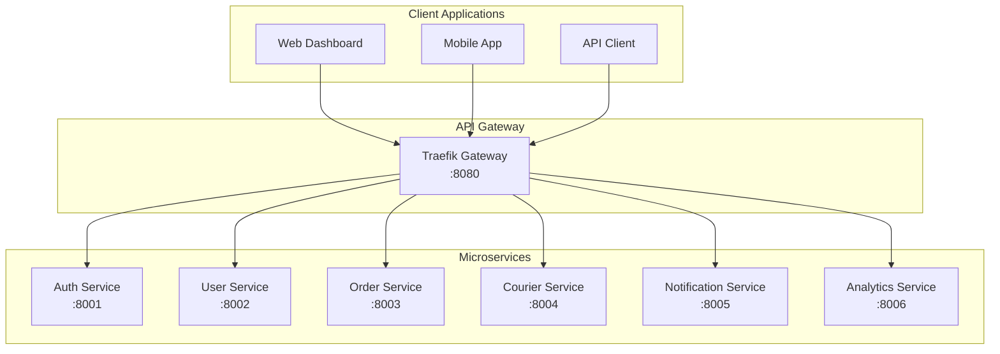

# 📚 Delox API Guide

This guide provides comprehensive documentation for the Delox SaaS Delivery Management System APIs.

## 🔗 Base URLs

- **Development**: `http://localhost:8080/api/v1`
- **Staging**: `https://staging-api.delox.com/api/v1`
- **Production**: `https://api.delox.com/api/v1`
- **API Gateway**: All requests go through the API gateway
- **Documentation**: `http://localhost:8080/docs` (Swagger UI)

## 🏗️ API Architecture



## 🔐 Authentication

All API endpoints (except registration and login) require authentication using JWT tokens.

### Authentication Flow

1. **Register/Login** to get access token
2. **Include token** in Authorization header: `Bearer <token>`
3. **Refresh token** when it expires

### Example Authentication

```bash
# Login
curl -X POST "http://localhost:8080/api/v1/auth/login" \
  -H "Content-Type: application/json" \
  -d '{
    "email": "admin@example.com",
    "password": "password123"
  }'

# Use token in subsequent requests
curl -X GET "http://localhost:8080/api/v1/users/me" \
  -H "Authorization: Bearer <your-access-token>"
```

## 🏢 Workspace Management

### Create Workspace (Registration)

```bash
POST /api/v1/workspaces/
{
  "name": "My Delivery Company",
  "description": "Professional delivery services",
  "primary_color": "#007bff"
}
```

### Get Workspace Info

```bash
GET /api/v1/workspaces/{workspace_id}
```

### Update Workspace

```bash
PUT /api/v1/workspaces/{workspace_id}
{
  "name": "Updated Company Name",
  "logo_url": "https://example.com/logo.png",
  "webhook_url": "https://your-app.com/webhooks/delox"
}
```

## 👥 User Management

### Get Current User

```bash
GET /api/v1/users/me
```

### List Users

```bash
GET /api/v1/users/?skip=0&limit=10&role=courier
```

### Create User

```bash
POST /api/v1/users/
{
  "email": "courier@example.com",
  "first_name": "John",
  "last_name": "Doe",
  "phone": "+1234567890",
  "role": "courier",
  "vehicle_type": "motorcycle",
  "vehicle_plate": "ABC123"
}
```

### Invite User

```bash
POST /api/v1/users/invitations
{
  "email": "newuser@example.com",
  "role": "employee"
}
```

### Accept Invitation

```bash
POST /api/v1/users/invitations/accept
{
  "invitation_token": "abc123...",
  "first_name": "Jane",
  "last_name": "Smith",
  "phone": "+1234567890"
}
```

## 📦 Order Management

### Create Order

```bash
POST /api/v1/orders/
{
  "customer_name": "John Customer",
  "customer_phone": "+1234567890",
  "customer_email": "customer@example.com",
  "pickup_address": "123 Pickup St, City, State 12345",
  "pickup_contact_name": "Store Manager",
  "pickup_contact_phone": "+1234567891",
  "delivery_address": "456 Delivery Ave, City, State 12345",
  "delivery_contact_name": "John Customer",
  "delivery_contact_phone": "+1234567890",
  "package_description": "Electronics package",
  "package_size": "medium",
  "package_weight": 2.5,
  "package_quantity": 1,
  "priority": "normal",
  "delivery_fee": 15.00,
  "cod_amount": 100.00,
  "external_id": "SHOP-ORDER-123",
  "tags": ["electronics", "fragile"]
}
```

### List Orders

```bash
GET /api/v1/orders/?skip=0&limit=10&status=created&priority=high
```

### Get Order

```bash
GET /api/v1/orders/{order_id}
```

### Update Order Status

```bash
PUT /api/v1/orders/{order_id}/status?new_status=picked_up
```

## 🚚 Courier Operations

### Get Assigned Orders (Courier App)

```bash
GET /api/v1/couriers/orders/assigned
```

### Update Location

```bash
POST /api/v1/couriers/location
{
  "latitude": 40.7128,
  "longitude": -74.0060,
  "accuracy": 10
}
```

### Update Order Status (Courier)

```bash
PUT /api/v1/couriers/orders/{order_id}/status
{
  "status": "delivered",
  "notes": "Package delivered to customer",
  "photo_url": "https://example.com/delivery-photo.jpg"
}
```

## 📊 Analytics

### Workspace Statistics

```bash
GET /api/v1/workspaces/{workspace_id}/stats
```

### Delivery Analytics

```bash
GET /api/v1/analytics/delivery-stats?period=last_30_days
```

### Courier Performance

```bash
GET /api/v1/analytics/courier-performance/{courier_id}?period=last_week
```

## 🔔 Notifications

### Send Custom Notification

```bash
POST /api/v1/notifications/send
{
  "recipient_type": "user",
  "recipient_id": "user-uuid",
  "type": "email",
  "subject": "Order Update",
  "message": "Your order has been delivered!",
  "data": {
    "order_id": "order-uuid"
  }
}
```

## 🔗 Webhook Integration

### Setup Webhook

```bash
PUT /api/v1/workspaces/{workspace_id}
{
  "webhook_url": "https://your-app.com/webhooks/delox",
  "webhook_secret": "your-secret-key"
}
```

### Webhook Events

Delox sends webhooks for these events:

- `order.created`
- `order.updated`
- `order.delivered`
- `order.failed`
- `courier.assigned`
- `courier.location_updated`

### Webhook Payload Example

```json
{
  "event": "order.delivered",
  "timestamp": "2024-01-15T10:30:00Z",
  "workspace_id": "workspace-uuid",
  "data": {
    "order_id": "order-uuid",
    "order_number": "ORD-000001",
    "status": "delivered",
    "delivered_at": "2024-01-15T10:30:00Z",
    "courier_id": "courier-uuid"
  }
}
```

## 🔒 Security Best Practices

### API Key Authentication (for integrations)

```bash
curl -X POST "http://localhost:8080/api/v1/orders/" \
  -H "X-API-Key: dlx_your_api_key_here" \
  -H "Content-Type: application/json" \
  -d '{ ... }'
```

### Rate Limiting

- **Default**: 60 requests per minute per IP
- **Burst**: 10 requests in quick succession
- **Headers**: Check `X-RateLimit-*` headers in responses

### Error Handling

All errors follow this format:

```json
{
  "success": false,
  "error": "Error message",
  "status_code": 400,
  "details": {
    "field": "Additional error details"
  }
}
```

## 📱 Mobile App Integration

### Courier App Endpoints

```bash
# Login
POST /api/v1/auth/login

# Get assigned orders
GET /api/v1/couriers/orders/assigned

# Update location
POST /api/v1/couriers/location

# Update order status
PUT /api/v1/couriers/orders/{order_id}/status

# Upload delivery photo
POST /api/v1/couriers/orders/{order_id}/photo
```

## 🧪 Testing

### Postman Collection

Import the Postman collection from `/docs/postman/delox-api.json`

### Example Test Workflow

1. **Create workspace** (registration)
2. **Login** to get access token
3. **Create users** (employees, couriers)
4. **Create orders**
5. **Assign orders** to couriers
6. **Update order status** through delivery lifecycle
7. **Check analytics** and reports

## 🚀 Quick Start Example

```bash
# 1. Create workspace
WORKSPACE=$(curl -X POST "http://localhost:8080/api/v1/workspaces/" \
  -H "Content-Type: application/json" \
  -d '{"name": "Test Company"}' | jq -r '.id')

# 2. Register admin user (implement this endpoint)
# 3. Login and get token
TOKEN=$(curl -X POST "http://localhost:8080/api/v1/auth/login" \
  -H "Content-Type: application/json" \
  -d '{"email": "admin@test.com", "password": "password123"}' \
  | jq -r '.tokens.access_token')

# 4. Create order
curl -X POST "http://localhost:8080/api/v1/orders/" \
  -H "Authorization: Bearer $TOKEN" \
  -H "Content-Type: application/json" \
  -d '{
    "customer_name": "Test Customer",
    "customer_phone": "+1234567890",
    "pickup_address": "123 Pickup St",
    "delivery_address": "456 Delivery Ave",
    "package_description": "Test package"
  }'
```

## 📞 Support

- **Documentation**: `/docs` endpoint on each service
- **Health Checks**: `/health` endpoint on each service
- **Logs**: Use `docker-compose logs -f` for development
