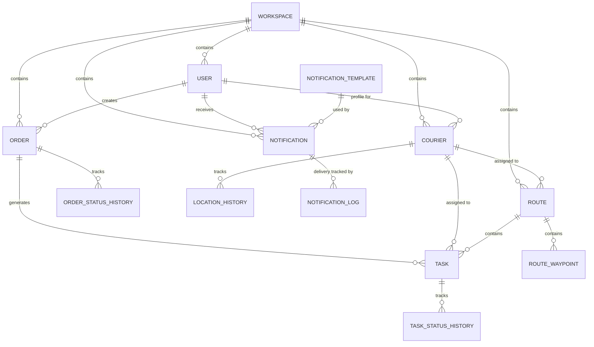

# 🗄️ Database Schema Documentation

## Overview

Delox uses PostgreSQL as the primary database with a multi-tenant architecture. All tables include `workspace_id` for tenant isolation and follow consistent naming conventions.

## 🏗️ Schema Design Principles

- **Multi-Tenant Isolation**: Every table includes `workspace_id` for data separation
- **UUID Primary Keys**: All entities use UUID for better distribution and security
- **Audit Trails**: `created_at` and `updated_at` timestamps on all tables
- **Soft Deletes**: Important entities support soft deletion with `is_active` flags
- **Referential Integrity**: Foreign key constraints maintain data consistency

## 📊 Entity Relationship Diagram



## 🏢 Core Tables

### Workspaces Table
```sql
CREATE TABLE workspaces (
    id UUID PRIMARY KEY DEFAULT gen_random_uuid(),
    name VARCHAR(255) NOT NULL,
    description TEXT,
    logo_url VARCHAR(500),
    primary_color VARCHAR(7) DEFAULT '#1976d2',
    secondary_color VARCHAR(7) DEFAULT '#dc004e',
    is_active BOOLEAN DEFAULT true,
    created_at TIMESTAMP WITH TIME ZONE DEFAULT CURRENT_TIMESTAMP,
    updated_at TIMESTAMP WITH TIME ZONE DEFAULT CURRENT_TIMESTAMP,
    
    CONSTRAINT workspaces_name_unique UNIQUE (name)
);
```

### Users Table
```sql
CREATE TABLE users (
    id UUID PRIMARY KEY DEFAULT gen_random_uuid(),
    workspace_id UUID NOT NULL REFERENCES workspaces(id) ON DELETE CASCADE,
    email VARCHAR(255) NOT NULL,
    password_hash VARCHAR(255) NOT NULL,
    first_name VARCHAR(100) NOT NULL,
    last_name VARCHAR(100) NOT NULL,
    role user_role NOT NULL DEFAULT 'employee',
    is_active BOOLEAN DEFAULT true,
    last_login_at TIMESTAMP WITH TIME ZONE,
    created_at TIMESTAMP WITH TIME ZONE DEFAULT CURRENT_TIMESTAMP,
    updated_at TIMESTAMP WITH TIME ZONE DEFAULT CURRENT_TIMESTAMP,
    
    CONSTRAINT users_email_workspace_unique UNIQUE (email, workspace_id)
);

-- User roles enum
CREATE TYPE user_role AS ENUM ('admin', 'manager', 'employee', 'courier');
```

## 📦 Order Management Tables

### Orders Table
```sql
CREATE TABLE orders (
    id UUID PRIMARY KEY DEFAULT gen_random_uuid(),
    workspace_id UUID NOT NULL REFERENCES workspaces(id) ON DELETE CASCADE,
    user_id UUID NOT NULL REFERENCES users(id) ON DELETE RESTRICT,
    order_number VARCHAR(50) NOT NULL,
    customer_name VARCHAR(255) NOT NULL,
    customer_email VARCHAR(255),
    customer_phone VARCHAR(20),
    pickup_address TEXT NOT NULL,
    pickup_latitude DECIMAL(10, 8),
    pickup_longitude DECIMAL(11, 8),
    delivery_address TEXT NOT NULL,
    delivery_latitude DECIMAL(10, 8),
    delivery_longitude DECIMAL(11, 8),
    package_description TEXT,
    package_weight DECIMAL(8, 2),
    package_size package_size NOT NULL DEFAULT 'medium',
    priority order_priority NOT NULL DEFAULT 'normal',
    status order_status NOT NULL DEFAULT 'created',
    scheduled_pickup TIMESTAMP WITH TIME ZONE,
    scheduled_delivery TIMESTAMP WITH TIME ZONE,
    actual_pickup TIMESTAMP WITH TIME ZONE,
    actual_delivery TIMESTAMP WITH TIME ZONE,
    delivery_fee DECIMAL(10, 2) NOT NULL DEFAULT 0,
    total_amount DECIMAL(10, 2) NOT NULL,
    notes TEXT,
    tracking_code VARCHAR(100) NOT NULL,
    courier_id UUID REFERENCES couriers(id) ON DELETE SET NULL,
    created_at TIMESTAMP WITH TIME ZONE DEFAULT CURRENT_TIMESTAMP,
    updated_at TIMESTAMP WITH TIME ZONE DEFAULT CURRENT_TIMESTAMP,
    
    CONSTRAINT orders_order_number_workspace_unique UNIQUE (order_number, workspace_id),
    CONSTRAINT orders_tracking_code_unique UNIQUE (tracking_code)
);

-- Order enums
CREATE TYPE order_status AS ENUM (
    'created', 'confirmed', 'assigned', 'picked_up', 
    'in_transit', 'out_for_delivery', 'delivered', 
    'failed', 'cancelled', 'returned'
);

CREATE TYPE order_priority AS ENUM ('low', 'normal', 'high', 'urgent');
CREATE TYPE package_size AS ENUM ('small', 'medium', 'large', 'extra_large');
```

### Order Status History
```sql
CREATE TABLE order_status_history (
    id UUID PRIMARY KEY DEFAULT gen_random_uuid(),
    workspace_id UUID NOT NULL REFERENCES workspaces(id) ON DELETE CASCADE,
    order_id UUID NOT NULL REFERENCES orders(id) ON DELETE CASCADE,
    status order_status NOT NULL,
    notes TEXT,
    changed_by UUID REFERENCES users(id) ON DELETE SET NULL,
    created_at TIMESTAMP WITH TIME ZONE DEFAULT CURRENT_TIMESTAMP
);
```

## 🚚 Courier Management Tables

### Couriers Table
```sql
CREATE TABLE couriers (
    id UUID PRIMARY KEY DEFAULT gen_random_uuid(),
    workspace_id UUID NOT NULL REFERENCES workspaces(id) ON DELETE CASCADE,
    user_id UUID NOT NULL REFERENCES users(id) ON DELETE CASCADE,
    status courier_status NOT NULL DEFAULT 'offline',
    is_available BOOLEAN DEFAULT true,
    current_latitude DECIMAL(10, 8),
    current_longitude DECIMAL(11, 8),
    location_updated_at TIMESTAMP WITH TIME ZONE,
    vehicle_type VARCHAR(50),
    vehicle_plate VARCHAR(20),
    vehicle_capacity DECIMAL(8, 2),
    max_delivery_distance DECIMAL(8, 2),
    working_hours_start TIME,
    working_hours_end TIME,
    working_days INTEGER[] DEFAULT '{1,2,3,4,5}', -- Monday to Friday
    total_deliveries INTEGER DEFAULT 0,
    successful_deliveries INTEGER DEFAULT 0,
    average_rating DECIMAL(3, 2),
    current_route_id UUID REFERENCES routes(id) ON DELETE SET NULL,
    active_tasks_count INTEGER DEFAULT 0,
    last_seen_at TIMESTAMP WITH TIME ZONE,
    created_at TIMESTAMP WITH TIME ZONE DEFAULT CURRENT_TIMESTAMP,
    updated_at TIMESTAMP WITH TIME ZONE DEFAULT CURRENT_TIMESTAMP,
    
    CONSTRAINT couriers_user_workspace_unique UNIQUE (user_id, workspace_id)
);

-- Courier status enum
CREATE TYPE courier_status AS ENUM ('available', 'busy', 'offline', 'on_break');
```

### Location History
```sql
CREATE TABLE location_history (
    id UUID PRIMARY KEY DEFAULT gen_random_uuid(),
    workspace_id UUID NOT NULL REFERENCES workspaces(id) ON DELETE CASCADE,
    courier_id UUID NOT NULL REFERENCES couriers(id) ON DELETE CASCADE,
    latitude DECIMAL(10, 8) NOT NULL,
    longitude DECIMAL(11, 8) NOT NULL,
    accuracy DECIMAL(8, 2),
    speed DECIMAL(8, 2),
    heading DECIMAL(5, 2),
    recorded_at TIMESTAMP WITH TIME ZONE DEFAULT CURRENT_TIMESTAMP
);

-- Index for efficient location queries
CREATE INDEX idx_location_history_courier_time ON location_history(courier_id, recorded_at DESC);
```

## 🛣️ Route Management Tables

### Routes Table
```sql
CREATE TABLE routes (
    id UUID PRIMARY KEY DEFAULT gen_random_uuid(),
    workspace_id UUID NOT NULL REFERENCES workspaces(id) ON DELETE CASCADE,
    route_name VARCHAR(255) NOT NULL,
    status route_status NOT NULL DEFAULT 'pending',
    courier_id UUID REFERENCES couriers(id) ON DELETE SET NULL,
    total_distance_km DECIMAL(8, 2),
    estimated_duration_minutes INTEGER,
    total_orders INTEGER DEFAULT 0,
    planned_start_time TIMESTAMP WITH TIME ZONE,
    actual_start_time TIMESTAMP WITH TIME ZONE,
    planned_end_time TIMESTAMP WITH TIME ZONE,
    actual_end_time TIMESTAMP WITH TIME ZONE,
    completed_tasks INTEGER DEFAULT 0,
    failed_tasks INTEGER DEFAULT 0,
    waypoints JSONB,
    created_at TIMESTAMP WITH TIME ZONE DEFAULT CURRENT_TIMESTAMP,
    updated_at TIMESTAMP WITH TIME ZONE DEFAULT CURRENT_TIMESTAMP
);

-- Route status enum
CREATE TYPE route_status AS ENUM (
    'pending', 'optimizing', 'optimized', 'in_progress', 'completed', 'failed'
);
```

### Route Waypoints
```sql
CREATE TABLE route_waypoints (
    id UUID PRIMARY KEY DEFAULT gen_random_uuid(),
    workspace_id UUID NOT NULL REFERENCES workspaces(id) ON DELETE CASCADE,
    route_id UUID NOT NULL REFERENCES routes(id) ON DELETE CASCADE,
    sequence_number INTEGER NOT NULL,
    latitude DECIMAL(10, 8) NOT NULL,
    longitude DECIMAL(11, 8) NOT NULL,
    address TEXT,
    waypoint_type waypoint_type NOT NULL,
    estimated_arrival TIMESTAMP WITH TIME ZONE,
    actual_arrival TIMESTAMP WITH TIME ZONE,
    created_at TIMESTAMP WITH TIME ZONE DEFAULT CURRENT_TIMESTAMP,
    
    CONSTRAINT route_waypoints_sequence_unique UNIQUE (route_id, sequence_number)
);

-- Waypoint type enum
CREATE TYPE waypoint_type AS ENUM ('pickup', 'delivery', 'depot', 'break');
```

## 📋 Task Management Tables

### Tasks Table
```sql
CREATE TABLE tasks (
    id UUID PRIMARY KEY DEFAULT gen_random_uuid(),
    workspace_id UUID NOT NULL REFERENCES workspaces(id) ON DELETE CASCADE,
    order_id UUID NOT NULL REFERENCES orders(id) ON DELETE CASCADE,
    task_type task_type NOT NULL,
    courier_id UUID REFERENCES couriers(id) ON DELETE SET NULL,
    route_id UUID REFERENCES routes(id) ON DELETE SET NULL,
    status task_status NOT NULL DEFAULT 'pending',
    sequence_number INTEGER,
    address TEXT NOT NULL,
    latitude DECIMAL(10, 8),
    longitude DECIMAL(11, 8),
    contact_name VARCHAR(255),
    contact_phone VARCHAR(20),
    scheduled_time TIMESTAMP WITH TIME ZONE,
    estimated_arrival TIMESTAMP WITH TIME ZONE,
    actual_arrival TIMESTAMP WITH TIME ZONE,
    completed_at TIMESTAMP WITH TIME ZONE,
    notes TEXT,
    special_instructions TEXT,
    completion_notes TEXT,
    failure_reason TEXT,
    customer_rating INTEGER CHECK (customer_rating >= 1 AND customer_rating <= 5),
    created_at TIMESTAMP WITH TIME ZONE DEFAULT CURRENT_TIMESTAMP,
    updated_at TIMESTAMP WITH TIME ZONE DEFAULT CURRENT_TIMESTAMP
);

-- Task enums
CREATE TYPE task_type AS ENUM ('pickup', 'delivery', 'return');
CREATE TYPE task_status AS ENUM (
    'pending', 'assigned', 'in_progress', 'completed', 'failed', 'cancelled'
);
```

### Task Status History
```sql
CREATE TABLE task_status_history (
    id UUID PRIMARY KEY DEFAULT gen_random_uuid(),
    workspace_id UUID NOT NULL REFERENCES workspaces(id) ON DELETE CASCADE,
    task_id UUID NOT NULL REFERENCES tasks(id) ON DELETE CASCADE,
    status task_status NOT NULL,
    notes TEXT,
    changed_by UUID REFERENCES users(id) ON DELETE SET NULL,
    created_at TIMESTAMP WITH TIME ZONE DEFAULT CURRENT_TIMESTAMP
);
```

## 🔔 Notification Tables

### Notification Templates
```sql
CREATE TABLE notification_templates (
    id UUID PRIMARY KEY DEFAULT gen_random_uuid(),
    workspace_id UUID NOT NULL REFERENCES workspaces(id) ON DELETE CASCADE,
    name VARCHAR(255) NOT NULL,
    type notification_type NOT NULL,
    channel notification_channel NOT NULL,
    subject VARCHAR(500),
    body TEXT NOT NULL,
    variables JSONB,
    is_active BOOLEAN DEFAULT true,
    created_at TIMESTAMP WITH TIME ZONE DEFAULT CURRENT_TIMESTAMP,
    updated_at TIMESTAMP WITH TIME ZONE DEFAULT CURRENT_TIMESTAMP,
    
    CONSTRAINT notification_templates_name_workspace_unique UNIQUE (name, workspace_id)
);

-- Notification enums
CREATE TYPE notification_type AS ENUM (
    'order_created', 'order_assigned', 'order_picked_up', 'order_delivered',
    'order_failed', 'courier_assigned', 'route_optimized', 'system_alert'
);

CREATE TYPE notification_channel AS ENUM ('email', 'sms', 'push', 'in_app');
```

### Notifications
```sql
CREATE TABLE notifications (
    id UUID PRIMARY KEY DEFAULT gen_random_uuid(),
    workspace_id UUID NOT NULL REFERENCES workspaces(id) ON DELETE CASCADE,
    template_id UUID REFERENCES notification_templates(id) ON DELETE SET NULL,
    recipient_id UUID REFERENCES users(id) ON DELETE CASCADE,
    type notification_type NOT NULL,
    channel notification_channel NOT NULL,
    subject VARCHAR(500),
    body TEXT NOT NULL,
    status notification_status NOT NULL DEFAULT 'pending',
    scheduled_at TIMESTAMP WITH TIME ZONE DEFAULT CURRENT_TIMESTAMP,
    sent_at TIMESTAMP WITH TIME ZONE,
    delivered_at TIMESTAMP WITH TIME ZONE,
    read_at TIMESTAMP WITH TIME ZONE,
    metadata JSONB,
    created_at TIMESTAMP WITH TIME ZONE DEFAULT CURRENT_TIMESTAMP
);

-- Notification status enum
CREATE TYPE notification_status AS ENUM (
    'pending', 'sent', 'delivered', 'failed', 'cancelled'
);
```

## 📊 Analytics Tables

### Delivery Metrics
```sql
CREATE TABLE delivery_metrics (
    id UUID PRIMARY KEY DEFAULT gen_random_uuid(),
    workspace_id UUID NOT NULL REFERENCES workspaces(id) ON DELETE CASCADE,
    date DATE NOT NULL,
    total_orders INTEGER DEFAULT 0,
    completed_orders INTEGER DEFAULT 0,
    failed_orders INTEGER DEFAULT 0,
    cancelled_orders INTEGER DEFAULT 0,
    average_delivery_time_minutes INTEGER,
    total_revenue DECIMAL(12, 2) DEFAULT 0,
    total_distance_km DECIMAL(10, 2) DEFAULT 0,
    created_at TIMESTAMP WITH TIME ZONE DEFAULT CURRENT_TIMESTAMP,
    
    CONSTRAINT delivery_metrics_date_workspace_unique UNIQUE (date, workspace_id)
);
```

### Courier Metrics
```sql
CREATE TABLE courier_metrics (
    id UUID PRIMARY KEY DEFAULT gen_random_uuid(),
    workspace_id UUID NOT NULL REFERENCES workspaces(id) ON DELETE CASCADE,
    courier_id UUID NOT NULL REFERENCES couriers(id) ON DELETE CASCADE,
    date DATE NOT NULL,
    total_deliveries INTEGER DEFAULT 0,
    successful_deliveries INTEGER DEFAULT 0,
    failed_deliveries INTEGER DEFAULT 0,
    total_distance_km DECIMAL(10, 2) DEFAULT 0,
    total_working_hours DECIMAL(5, 2) DEFAULT 0,
    average_rating DECIMAL(3, 2),
    revenue_generated DECIMAL(10, 2) DEFAULT 0,
    created_at TIMESTAMP WITH TIME ZONE DEFAULT CURRENT_TIMESTAMP,
    
    CONSTRAINT courier_metrics_date_courier_unique UNIQUE (date, courier_id)
);
```

## 🔍 Indexes and Performance

### Essential Indexes
```sql
-- Multi-tenant isolation indexes
CREATE INDEX idx_users_workspace_id ON users(workspace_id);
CREATE INDEX idx_orders_workspace_id ON orders(workspace_id);
CREATE INDEX idx_couriers_workspace_id ON couriers(workspace_id);
CREATE INDEX idx_tasks_workspace_id ON tasks(workspace_id);

-- Performance indexes
CREATE INDEX idx_orders_status ON orders(status);
CREATE INDEX idx_orders_created_at ON orders(created_at DESC);
CREATE INDEX idx_orders_courier_id ON orders(courier_id);

CREATE INDEX idx_tasks_courier_id ON tasks(courier_id);
CREATE INDEX idx_tasks_status ON tasks(status);
CREATE INDEX idx_tasks_scheduled_time ON tasks(scheduled_time);

CREATE INDEX idx_couriers_status ON couriers(status);
CREATE INDEX idx_couriers_location ON couriers(current_latitude, current_longitude);

-- Composite indexes for common queries
CREATE INDEX idx_orders_workspace_status ON orders(workspace_id, status);
CREATE INDEX idx_tasks_courier_status ON tasks(courier_id, status);
CREATE INDEX idx_notifications_recipient_read ON notifications(recipient_id, read_at);
```

### Row Level Security (RLS)
```sql
-- Enable RLS on all tables
ALTER TABLE users ENABLE ROW LEVEL SECURITY;
ALTER TABLE orders ENABLE ROW LEVEL SECURITY;
ALTER TABLE couriers ENABLE ROW LEVEL SECURITY;
ALTER TABLE tasks ENABLE ROW LEVEL SECURITY;
ALTER TABLE notifications ENABLE ROW LEVEL SECURITY;

-- Example RLS policy for orders
CREATE POLICY orders_workspace_isolation ON orders
    FOR ALL
    TO authenticated_users
    USING (workspace_id = current_setting('app.current_workspace_id')::UUID);
```

## 🔧 Database Functions and Triggers

### Auto-update timestamps
```sql
CREATE OR REPLACE FUNCTION update_updated_at_column()
RETURNS TRIGGER AS $$
BEGIN
    NEW.updated_at = CURRENT_TIMESTAMP;
    RETURN NEW;
END;
$$ language 'plpgsql';

-- Apply to all tables
CREATE TRIGGER update_users_updated_at BEFORE UPDATE ON users
    FOR EACH ROW EXECUTE FUNCTION update_updated_at_column();

CREATE TRIGGER update_orders_updated_at BEFORE UPDATE ON orders
    FOR EACH ROW EXECUTE FUNCTION update_updated_at_column();
```

### Generate tracking codes
```sql
CREATE OR REPLACE FUNCTION generate_tracking_code()
RETURNS TRIGGER AS $$
BEGIN
    IF NEW.tracking_code IS NULL OR NEW.tracking_code = '' THEN
        NEW.tracking_code = 'DLX' || UPPER(SUBSTRING(gen_random_uuid()::text, 1, 8));
    END IF;
    RETURN NEW;
END;
$$ language 'plpgsql';

CREATE TRIGGER generate_order_tracking_code BEFORE INSERT ON orders
    FOR EACH ROW EXECUTE FUNCTION generate_tracking_code();
```

This database schema provides a solid foundation for the Delox delivery management system with proper multi-tenant isolation, performance optimization, and data integrity.
