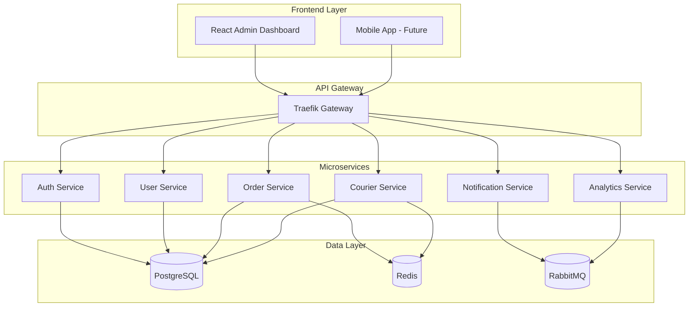

# 📚 Delox Documentation Hub

Welcome to the comprehensive documentation for the Delox SaaS Delivery Management System. This documentation covers everything from system architecture to deployment strategies.

## 🎯 Quick Navigation

### 🏗️ System Design
- [**System Architecture**](ARCHITECTURE.md) - Complete system design, microservices architecture, and technical diagrams
- [**Database Schema**](DATABASE_SCHEMA.md) - Database design, entity relationships, and multi-tenant structure

### 🔧 Development
- [**API Guide**](API_GUIDE.md) - Complete API documentation with examples and authentication
- [**Development Setup**](DEVELOPMENT.md) - Local development environment setup *(Coming Soon)*
- [**Testing Guide**](TESTING.md) - Testing strategies and examples *(Coming Soon)*

### 🚀 Deployment
- [**Deployment Guide**](DEPLOYMENT_GUIDE.md) - Production deployment strategies for Docker, Kubernetes, and cloud platforms
- [**Security Guide**](SECURITY.md) - Security best practices and configurations *(Coming Soon)*
- [**Performance Guide**](PERFORMANCE.md) - Optimization and scaling strategies *(Coming Soon)*

## 📊 Architecture Overview



## 🔍 Key Features Documentation

### 🏢 Multi-Tenant SaaS
- **Workspace Isolation**: Complete data separation between tenants
- **Role-Based Access Control**: Admin, Manager, Employee, Courier roles
- **Custom Branding**: Workspace-specific theming and configuration

### 📦 Order Management
- **Complete Lifecycle**: From creation to delivery completion
- **Real-time Tracking**: Live status updates and GPS tracking
- **Customer Management**: Comprehensive customer information handling
- **Webhook Integration**: External system notifications

### 🚚 Courier & Route Management
- **GPS Tracking**: Real-time location monitoring
- **Route Optimization**: Intelligent route planning algorithms
- **Task Assignment**: Manual and automatic task distribution
- **Performance Analytics**: Courier performance metrics

### 🔔 Notification System
- **Multi-Channel**: Email, SMS, Push, In-App notifications
- **Template Management**: Customizable notification templates
- **Campaign Management**: Bulk notification campaigns
- **Delivery Tracking**: Notification delivery analytics

### 📊 Analytics & Reporting
- **Real-time Dashboards**: Live business metrics
- **Performance Reports**: Delivery and courier analytics
- **Revenue Tracking**: Financial reporting and insights
- **Custom Metrics**: Configurable KPI tracking

## 🛠️ Technology Stack

### Frontend
- **React 18** with TypeScript
- **Material-UI (MUI)** for components
- **React Query** for state management
- **React Hook Form** for form handling
- **Leaflet** for maps and GPS tracking

### Backend
- **Python 3.9+** with FastAPI
- **PostgreSQL 15** for primary database
- **Redis 6** for caching and sessions
- **RabbitMQ** for message queuing
- **SQLAlchemy** for ORM

### Infrastructure
- **Docker** for containerization
- **Traefik** for API gateway
- **Kubernetes** for orchestration
- **Prometheus & Grafana** for monitoring

## 🚀 Getting Started

### Quick Start (5 minutes)
```bash
# Clone and setup
git clone <repository-url>
cd delox-delivery-system
cp .env.example .env

# Install and start
make install-frontend
make up
make init-db

# Access the application
# Frontend: http://localhost:3000
# API: http://localhost:8080
```

### Development Workflow
1. **Setup Environment**: Follow the [Development Setup](DEVELOPMENT.md) guide
2. **Understand Architecture**: Read the [System Architecture](ARCHITECTURE.md) documentation
3. **Explore APIs**: Use the [API Guide](API_GUIDE.md) for integration
4. **Deploy**: Follow the [Deployment Guide](DEPLOYMENT_GUIDE.md) for production

## 📈 Scalability & Performance

### Horizontal Scaling
- **Microservices**: Each service scales independently
- **Load Balancing**: Traefik handles request distribution
- **Database Sharding**: Multi-tenant data partitioning
- **Caching Strategy**: Redis for performance optimization

### Monitoring & Observability
- **Health Checks**: Service health monitoring
- **Metrics Collection**: Prometheus metrics
- **Log Aggregation**: Centralized logging
- **Alerting**: Automated incident response

## 🔒 Security Features

### Authentication & Authorization
- **JWT Tokens**: Secure authentication mechanism
- **Multi-Factor Authentication**: Enhanced security *(Future)*
- **Role-Based Access**: Granular permission control
- **Session Management**: Secure session handling

### Data Protection
- **Encryption**: Data encryption at rest and in transit
- **Multi-Tenant Isolation**: Complete data separation
- **Audit Logging**: Comprehensive activity tracking
- **GDPR Compliance**: Privacy regulation compliance

## 🤝 Contributing

We welcome contributions to both the codebase and documentation! 

### Documentation Contributions
- **Improve Existing Docs**: Fix typos, add examples, clarify instructions
- **Add New Guides**: Create guides for missing topics
- **Update Diagrams**: Improve or add new architectural diagrams
- **Translate**: Help translate documentation to other languages

### Code Contributions
- **Bug Fixes**: Report and fix issues
- **Feature Development**: Add new features
- **Performance Improvements**: Optimize existing code
- **Testing**: Improve test coverage

## 📞 Support & Community

- **GitHub Issues**: Report bugs and request features
- **Discussions**: Community discussions and Q&A
- **Documentation**: This comprehensive documentation
- **Examples**: Sample implementations and use cases

## 📋 Documentation Status

| Document | Status | Last Updated |
|----------|--------|--------------|
| [Architecture](ARCHITECTURE.md) | ✅ Complete | 2024-01-15 |
| [Database Schema](DATABASE_SCHEMA.md) | ✅ Complete | 2024-01-15 |
| [API Guide](API_GUIDE.md) | 🔄 In Progress | 2024-01-15 |
| [Deployment Guide](DEPLOYMENT_GUIDE.md) | ✅ Complete | 2024-01-15 |
| Development Setup | 📝 Planned | - |
| Testing Guide | 📝 Planned | - |
| Security Guide | 📝 Planned | - |
| Performance Guide | 📝 Planned | - |

---

**Need help?** Check our [FAQ](FAQ.md) or open an issue on GitHub.

**Want to contribute?** See our [Contributing Guide](../CONTRIBUTING.md) to get started.
