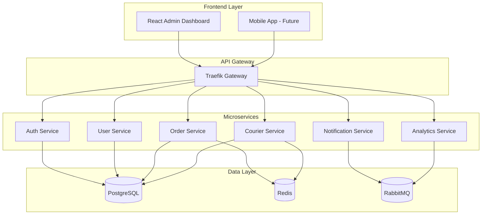

# 📚 Delox Documentation Hub

Welcome to the comprehensive documentation for the Delox SaaS Delivery Management System. This documentation covers everything from system architecture to deployment strategies.

## 🎯 Quick Navigation

### 🏗️ System Design
- [**System Architecture**](ARCHITECTURE.md) - Complete system design, microservices architecture, and technical diagrams
- [**Database Schema**](DATABASE_SCHEMA.md) - Database design, entity relationships, and multi-tenant structure

### 🔧 Development
- [**API Guide**](API_GUIDE.md) - Complete API documentation with examples and authentication
- [**Development Setup**](../README.md#development-setup) - Local development environment setup

### 🚀 Deployment
- [**Deployment Guide**](DEPLOYMENT_GUIDE.md) - Production deployment strategies for Docker, Kubernetes, and cloud platforms

## 📊 Architecture Overview



## 🔍 Key Features Documentation

### 🏢 Multi-Tenant SaaS
- **Workspace Isolation**: Complete data separation between tenants
- **Role-Based Access Control**: Admin, Manager, Employee, Courier roles
- **Custom Branding**: Workspace-specific themes and branding
- **Scalable Architecture**: Independent scaling per tenant

### 📦 Order Management
- **Complete Lifecycle**: From creation to delivery completion
- **Real-time Tracking**: Live status updates and GPS tracking
- **Customer Management**: Comprehensive customer information
- **Webhook Integration**: External system notifications

### 🚚 Courier & Route Management
- **GPS Tracking**: Real-time location monitoring
- **Route Optimization**: Intelligent route planning algorithms
- **Task Assignment**: Manual and automatic task distribution
- **Performance Analytics**: Courier performance metrics

### 🔔 Notification System
- **Multi-Channel**: Email, SMS, Push, In-App notifications
- **Template Management**: Customizable notification templates
- **Campaign Management**: Bulk notification campaigns
- **Delivery Tracking**: Notification delivery analytics

### 📊 Analytics & Reporting
- **Real-time Dashboards**: Live business metrics
- **Performance Reports**: Delivery and courier analytics
- **Revenue Tracking**: Financial reporting and insights
- **Custom Metrics**: Configurable KPIs and alerts

## 🛠️ Technology Stack

### Frontend
- **React 18** with TypeScript
- **Material-UI (MUI)** for components
- **React Query** for server state management
- **React Router** for navigation
- **Recharts** for data visualization
- **Leaflet** for maps and GPS tracking

### Backend
- **Python 3.9+** with FastAPI
- **SQLAlchemy** ORM with PostgreSQL
- **Redis** for caching and sessions
- **RabbitMQ** for message queuing
- **JWT** for authentication
- **Pydantic** for data validation

### Infrastructure
- **Docker** containerization
- **Traefik** API gateway
- **PostgreSQL** primary database
- **Redis** caching layer
- **RabbitMQ** message broker
- **Kubernetes** orchestration (production)

### External Integrations
- **Google Maps API** for geocoding and routing
- **Twilio** for SMS notifications
- **Firebase** for push notifications
- **SMTP** for email delivery

## 📋 Documentation Structure

```
docs/
├── README.md                 # This file - Documentation hub
├── ARCHITECTURE.md           # System architecture and design
├── DATABASE_SCHEMA.md        # Database design and relationships
├── API_GUIDE.md             # API documentation and examples
├── DEPLOYMENT_GUIDE.md      # Deployment strategies and guides
└── diagrams/                # Architecture diagrams and schemas
    ├── system-overview.png
    ├── database-erd.png
    ├── api-flow.png
    └── deployment-topology.png
```

## 🚀 Getting Started

### For Developers
1. Read the [System Architecture](ARCHITECTURE.md) to understand the overall design
2. Review the [Database Schema](DATABASE_SCHEMA.md) for data structure
3. Follow the [Development Setup](../README.md#development-setup) guide
4. Explore the [API Guide](API_GUIDE.md) for integration details

### For DevOps Engineers
1. Study the [Deployment Guide](DEPLOYMENT_GUIDE.md) for infrastructure setup
2. Review the [System Architecture](ARCHITECTURE.md) for scaling considerations
3. Check the monitoring and observability sections

### For Product Managers
1. Review the [System Architecture](ARCHITECTURE.md) for feature capabilities
2. Understand the multi-tenant model and scalability
3. Explore the analytics and reporting features

## 🔄 Documentation Updates

This documentation is actively maintained and updated with each release. For the latest information:

- Check the Git commit history for recent changes
- Review the changelog in each service directory
- Consult the API documentation for endpoint updates

## 📞 Support and Community

- **Issues**: Report bugs and feature requests on GitHub
- **Discussions**: Join community discussions for questions
- **Contributing**: See the main [Contributing Guide](../CONTRIBUTING.md)
- **Security**: Report security issues privately

## 📈 Roadmap

### Phase 1 (Current)
- ✅ Core microservices architecture
- ✅ Multi-tenant SaaS platform
- ✅ React admin dashboard
- ✅ Basic order and courier management

### Phase 2 (Next)
- 🔄 Mobile courier application
- 🔄 Advanced analytics and reporting
- 🔄 Customer portal
- 🔄 Advanced route optimization

### Phase 3 (Future)
- 📋 Machine learning for demand prediction
- 📋 IoT device integration
- 📋 Advanced workflow automation
- 📋 Multi-language support

---

**Last Updated**: December 2024  
**Version**: 1.0.0  
**Maintainers**: Delox Development Team
